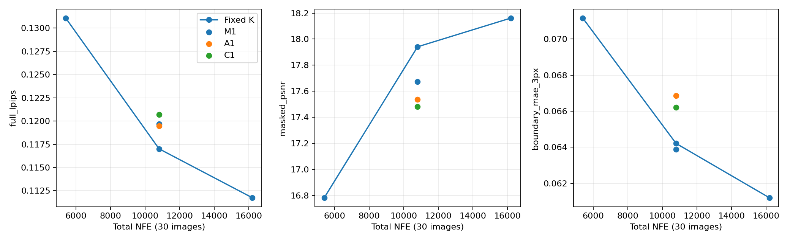
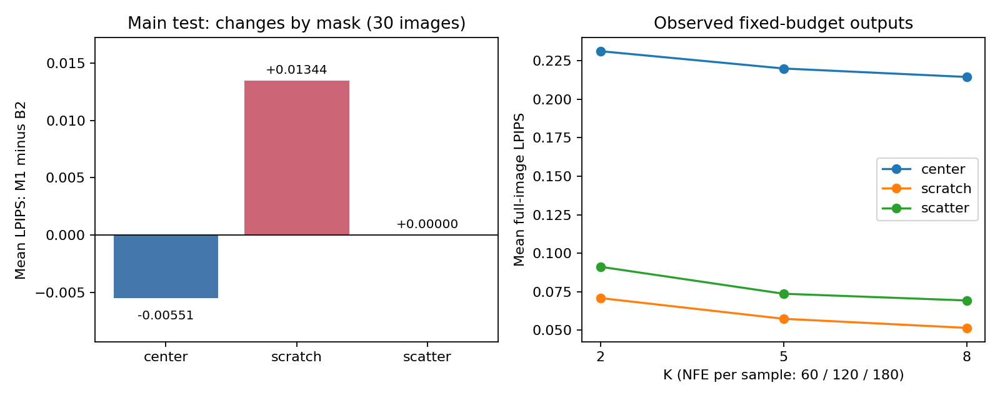
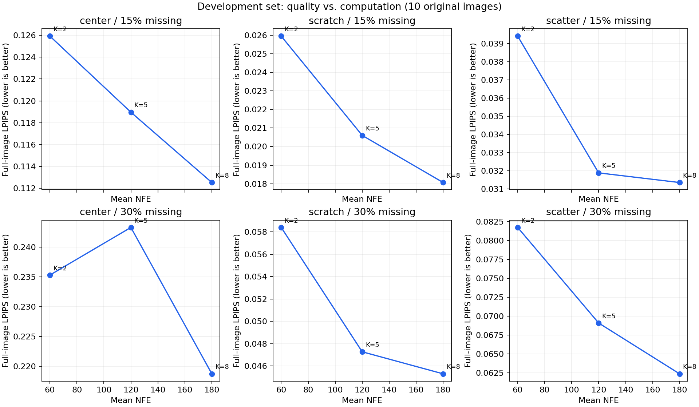

# LanPaint 掩码感知采样预算分配：最终实验报告

日期：2026-11-17（Asia/Shanghai）
范围：预训练 LanPaint 模型上的**推理预算分配**研究，不涉及重新训练或更换模型。
证据：本报告的数字全部来自已归档的正式实验与离线分析，未重新推理、未用测试集调参。

---

## 摘要

我们把 LanPaint 的内层采样迭代次数 `K` 从固定值改为按掩码特征（缺失面积、归一化边界长度）批量分档，在**总 NFE 相等**的约束下与固定预算基线比较修复质量。

结论是**负面但可信**的：开发集上自适应策略 M1 的全图 LPIPS 比固定 K=5 的 B2 低 3.46%，但在 30 张未见测试原图上反而高 2.26%（0.119657 vs 0.117012），配对差值 95% 区间 `[-0.001336, 0.006592]` 跨零，30 图中 12 图改善、18 图退化；缺失区 PSNR 显著变差（−0.2667 dB，区间 `[-0.4506, −0.0893]`）。小面积（15%）子集有改善，30% 面积与两个新增种子下均退化。

失败原因已定位到三点：把预算从划痕样本转移到中心遮挡样本时，中心的收益（−0.0055）小于划痕的损失（+0.0134）；批量排序依赖批次组成，同一冻结分数在单面积批次下得到不同档位；LPIPS 改善不等于语义恢复，个别样本指标更好但生成了更离谱的物体。

因此项目保留**固定 K=5** 为默认策略，M1 只作为已评测的实验策略归档。本报告同时给出 10 组案例、适用边界、复现步骤与 PRD 验收清单对照。

---

## 1. 研究问题与假设

**问题**：给定相同的总网络计算量，把计算量按掩码内容重新分配（大块/复杂边界多迭代、细长划痕少迭代）能否改善修复质量？

**预注册假设**（在看测试结果之前固定）：

- H1（主）：M1 在测试集上的全图 LPIPS 低于 B2（差值 < 0）。
- H2（辅）：M1 的缺失区 PSNR 与边界带 MAE 不显著变差。
- H3（稳定）：改善在 15%/30% 面积与多个随机种子下方向一致。

**判定规则**：以原图为重采样单位、10000 次配对 bootstrap 的 95% 百分位区间；区间跨零即视为“收益证据有限”。结果：H1 不成立，H2 部分不成立（PSNR 显著变差），H3 不成立（15% 改善、30% 退化）。

---

## 2. 方法与实现

### 2.1 预算分档与等预算约束

- 三档预算 `K ∈ {2, 5, 8}`，外层步数 `T = 20`，分辨率 256×256，FP32，关闭任何动态提前停止。
- 等预算条件：`low + high = 2 × middle`（2+8 = 2×5），因此任何满足“低/高各占 1/3、其余中档”的批量分配，总 NFE 都等于全中档。
- 批量分档：按分数升序排序，最低 `floor(N/3)` 个取 K=2，最高 `floor(N/3)` 个取 K=8，其余 K=5；同分按样本 ID 决定顺序，余数样本取中档。

### 2.2 六条策略

| 策略 | 定义 | 作用 |
|---|---|---|
| B1 / B2 / B3 | 全部样本固定 K=2 / 5 / 8 | 固定预算基线（B2 为主对照） |
| M1 | 分数 = `w_area·Ã + w_b·B̃`，冻结权重 `(1, −1)` | 面积大、边界短 → 高分 → 高预算 |
| A1 | 分数 = 面积项，权重 `(1, 0)` | 面积消融 |
| C1 | 与 M1 相同分数，按种子 42 打乱档位 | 控制“档位集合相同、分配不同” |

`Ã`、`B̃` 为在**开发集**上拟合的 min-max 归一化特征（常量特征归零、越界裁剪到 `[0,1]`）。

### 2.3 规则冻结

开发集完整跑完三档后，在受限候选权重中按“每原图平均全图 LPIPS 最低”选择，同分按候选顺序；再按分数三分位拟合单图阈值，与归一化参数、档位、采样参数、数据清单、源码指纹一起写入 `frozen_policy.json`（带 canonical SHA-256）。测试阶段只加载、不拟合；加载时校验采样 contract、源码指纹与开发集/测试集图片隔离。

产物：[frozen_policy.json](../results/raw/dev_budget/seed_42/20261116T084403334123Z_1d7f3deb/frozen_policy.json)（SHA-256 前 16 位 `8d0a53f75728cff8`）。

---

## 3. 实验设置

| 项 | 内容 |
|---|---|
| 数据划分 | 50 张 256×256 原图：检查 10 / 开发 10 / 测试 30，划分只依赖原图，互不重叠 |
| 掩码 | center（中心矩形）、scratch（细长划痕）、scatter（散布小块）；目标面积 15% / 30%，实际面积偏差 ≤ ±2pp |
| 清单 | `data/manifest.csv` 共 300 行（50 图 × 3 掩码 × 2 面积） |
| 测试集 | `img0020`–`img0049`（30 张），共同子集 `img0020`–`img0029`（10 张），在主测试前锁定 |
| 指标 | 主：全图 LPIPS（AlexNet）；辅：缺失区 PSNR、缺失区内侧 3px 带 MAE |
| 统计 | 先按原图平均三类掩码，再跨图配对；bootstrap 10000 次，分析种子 42；差值定义为 M1−B2 |
| 硬件 | Windows 11，RTX 5070 Laptop（约 8 GB 显存） |
| 环境 | Python 3.12.16、PyTorch 2.11.0+cu128、diffusers 0.34.0、lpips 0.1.4 |
| 上游 | `third_party/LanPaintBench` 固定 commit `ea5be5d9…63a2a`，只读引用；权重 `256x256_diffusion_uncond.pt` SHA-256 `A37C32FF…C78B1` |

### 3.1 运行规模与验收

| 运行 | 输入 | 新增生成 | 策略记录 | 等预算 NFE | 状态 |
|---|---|---:|---:|---|---|
| 开发集 | 10 图 × 3 掩码 × 2 面积 × 3 档 | 180 | 360 | 各 7200 | 0 失败，已冻结 |
| 主测试 | 30 图 × 3 掩码 × 30% × 种子 42 | 270 | 540 | B2/M1/A1/C1 各 10800 | 0 失败 |
| 面积扩展 | 10 图 × 3 掩码 × 15% | 90 | 180 | 各 3600 | 0 失败 |
| 种子 2026 / 3407 | 10 图 × 3 掩码 × 30% | 90 + 90 | 180 + 180 | 各 3600 | 0 失败 |

每个运行都必须满足 `status=ok`、`num_failures=0`、`comparison_complete=true`、`equal_nfe=true`，并核对输入图片/掩码哈希、唯一 `(样本, K)` 组合与结果图完整性。

**成本实测**：主测试 270 次生成记录采样耗时合计 9068 秒（2.52 h），四个正式运行合计约 4.46 h 纯采样；峰值显存 2731 MB；整个过程 0 次 OOM、0 次 NaN/全黑输出。耗时来自运行日志，缓存命中不重复计时。

---

## 4. 结果

### 4.1 开发集（选择 M1 的依据）

| 策略 | 平均全图 LPIPS | 缺失区 PSNR | 边界 MAE | 总 NFE |
|---|---:|---:|---:|---:|
| B1（K=2） | 0.094452 | 18.058 | 0.060508 | 3600 |
| **B2（K=5）** | 0.088518 | 19.149 | 0.057296 | 7200 |
| B3（K=8） | 0.081394 | 19.412 | 0.055540 | 10800 |
| **M1** | **0.085453** | 18.973 | 0.057748 | 7200 |
| A1 | 0.089444 | 18.817 | 0.057139 | 7200 |
| C1 | 0.089196 | 18.791 | 0.059480 | 7200 |

M1 相对 B2 的 LPIPS 改善 3.46%，但辅助指标略差（PSNR −0.18 dB、边界 MAE +0.00045）；B3 用 1.5 倍预算换到 8.0% 的 LPIPS 改善，说明“加预算”本身仍然有效，问题在于**等预算下如何切分**。

### 4.2 主测试：30 张未见原图

| 策略 | 平均全图 LPIPS | 缺失区 PSNR | 边界 MAE | 总 NFE | 相对 B2 的 LPIPS |
|---|---:|---:|---:|---:|---:|
| B1 | 0.131072 | 16.781 | 0.071163 | 5400 | +12.0% |
| **B2** | **0.117012** | **17.941** | 0.064209 | 10800 | — |
| B3 | 0.111747 | 18.162 | 0.061196 | 16200 | −4.5% |
| M1 | 0.119657 | 17.674 | **0.063890** | 10800 | **+2.26%** |
| A1 | 0.119457 | 17.537 | 0.066849 | 10800 | +2.09% |
| C1 | 0.120691 | 17.483 | 0.066219 | 10800 | +3.15% |



配对统计（M1−B2，按原图）：

| 指标 | 均值差 | 95% 区间 | 改善/持平/退化 |
|---|---:|---|---|
| 全图 LPIPS | +0.002645 | [−0.001336, 0.006592] | 12 / 0 / 18 |
| 缺失区 PSNR | −0.2667 dB | [−0.4506, −0.0893] | 10 / 0 / 20（越大越好） |
| 边界 MAE | −0.000319 | [−0.002322, 0.001527] | 16 / 0 / 14（越小越好） |

主指标区间跨零、均值方向不利，PSNR 显著变差，只有边界带误差略好但不显著。**不能声称 M1 优于固定 K=5。**

一个值得注意的对照：C1（同样的档位集合、随机分配）与 M1 的差距只有 0.001034，而两者都明显差于 B2。也就是说，在这批 30% 单面积样本上，“低/中/高混合”这一**预算组成**本身已经带来损失，分配方式的差异只占很小部分。这是观察，不是因果证明。

### 4.3 分掩码分解

| 掩码 | 主测试实际档位 | LPIPS 差值 | PSNR 差值 / dB | 边界 MAE 差值 | 改善/退化 |
|---|---:|---:|---:|---:|---|
| center | K=8 | −0.005508 | +0.107 | −0.006074 | 16 / 14 |
| scratch | K=2 | +0.013444 | −0.907 | +0.005117 | 2 / 28 |
| scatter | K=5 | 0 | 0 | 0 | 0 / 0 |

三组等权合成 `(−0.005508 + 0.013444 + 0)/3 = +0.002645`，与主报告一致。结论：**中心的额外预算收益不足以抵消划痕降预算的损失**；且从固定档位曲线看，划痕从 K=2 升到 K=5 有 28/30 样本改善（平均 0.0134），而中心从 K=5 升到 K=8 只有 16/30 改善（平均 0.0055）——当前规则恰好牺牲了收益更稳定的那一侧。



### 4.4 面积与种子复核

| 子集 | 原图 | M1−B2 LPIPS | 95% 区间 | 改善/退化 |
|---|---:|---:|---|---|
| 15% 面积，种子 42 | 10 | −0.004350 | [−0.008808, −0.000112] | 6 / 4 |
| 30% 面积，种子 42（同子集） | 10 | +0.004031 | [0.000257, 0.007658] | 2 / 8 |
| 两种面积等权合并 | 10 | −0.000159 | [−0.002769, 0.002443] | 5 / 5 |
| 30% 面积，种子 2026 | 10 | +0.007810 | [0.003932, 0.012154] | 1 / 9 |
| 30% 面积，种子 3407 | 10 | +0.007690 | [−0.002257, 0.017864] | 3 / 7 |
| 30% 面积三种子合并 | 10 | +0.006510 | [0.003505, 0.009525] | 1 / 9 |

15% 子集的改善集中在 center（−0.015408，9/10 图改善）；两个新增种子下 30% 面积的 center 反而变差（+0.0074 / +0.0090）。**不同面积与种子的方向不一致，不能事后把“小面积用 M1”当作已验证规则。**

### 4.5 质量—成本

- K=2 → K=5（2 倍计算）带来约 10.7% 的 LPIPS 下降；K=5 → K=8（1.5 倍）再降约 4.5%，边际收益递减。
- M1 用与 B2 相同的 10800 NFE 得到介于 B1 与 B2 之间的效果（0.119657，比 B1 好 8.7%、比 B2 差 2.26%），即**把预算按掩码重分配后，整体退化到了“略强于全 K=2、弱于全 K=5”的位置**。



---

## 5. 失败分析

### 5.1 预算转移的取舍被算反了

冻结规则给 center 高分（K=8）、scratch 低分（K=2）。按实际发生的移动计算：划痕从 K=5 降到 K=2，平均损失 0.013444（28/30 样本变差，只有 2 个变好）；中心从 K=5 升到 K=8，平均收益 0.005508（16/30 改善、14 个变差）。**降下来的那一侧赔得多，升上去的那一侧赚得少，而且赚得很不稳。**

问题出在开发集只用了 10 张图：同一动作在开发集 30% 子集上的收益是 0.024553（8/10 改善），看起来是六个格子中最大的一笔，所以规则选择了“抬中心”；到了 30 张主测试上，同一动作只剩 0.005508，缩小到约 1/4.5。与之相对，划痕 2→5 的收益在开发集（0.011127，10/10）与主测试（0.013444，28/30）之间基本稳定。也就是说，**在 10 图开发集上，中心升档的收益被高估了，而划痕的收益被低估了**——这是小样本选择规则的典型风险，不是“划痕不需要预算”的证明。

### 5.2 批量排序依赖批次组成

同一份冻结分数在不同批次里得到不同档位：

| 批次 | center 15% | scatter 15% | scratch 15% | center 30% | scatter 30% | scratch 30% |
|---|---:|---:|---:|---:|---:|---:|
| 开发集：两种面积混合排序 | 5 | 2 | 2 | 8 | 8 | 5 |
| 正式实验：各面积单独排序 | 8 | 5 | 2 | 8 | 5 | 2 |

开发集上 30% 划痕保留 K=5、30% 散点拿到 K=8；主测试中划痕被降到 K=2、散点回到 K=5。原因很简单：分档是**批内相对排名**，批次里混入 15% 样本时，30% 的中心样本被“顶”到高档、划痕被“挤”到低档。这说明部署时的批次组成必须与开发集一致，否则冻结的阈值/权重不保证同样的档位。

### 5.3 指标与语义脱节

LPIPS 是全图感知距离，对“填补得像背景”这一策略很宽容：把被遮挡的蛇头抹成平滑背景，比生成一个颜色突兀的鸟头得分更高。案例 1（img0036）与案例 2（img0025）都是“LPIPS 改善、语义更离谱”的直接证据。**单一 LPIPS 数字不足以支撑“修复质量提升”的说法**，报告因此同时给出 PSNR、边界误差与目视核对。

---

## 6. 案例：10 组（5 改善 + 5 退化）

选图规则在看结果前固定：按主测试每张原图的三掩码平均 LPIPS 差值排序，取最负的 5 个与最正的 5 个，同分按原图 ID；每张图都展示全部三类掩码，不用“挑最好看的掩码”；放大框固定取距图像中心最近的缺失区边界像素，与误差大小无关。

| 排序 | 原图 | 平均差值 | 中心 / 划痕 / 散点 | 观察 |
|---|---|---:|---|---|
| 改善 1 | img0043 | −0.021797 | −0.0748 / +0.0094 / 0 | 路由设备：K=8 减少了 K=5 的红绿块，但生成不属于原图的白色形体；划痕 K=2 面板文字更不完整 |
| 改善 2 | img0044 | −0.015756 | −0.0632 / +0.0160 / 0 | 圆桶：K=8 颜色更接近，但桶身变成上下分节的支座结构 |
| 改善 3 | img0046 | −0.012397 | −0.0417 / +0.0045 / 0 | 犬：两档都生成鸟状身体，K=8 只是 LPIPS 更低 |
| 改善 4 | img0036 | −0.011328 | −0.0461 / +0.0121 / 0 | 蛇：K=5 生成白色鸟头+橙色块，K=8 改为平滑背景，分数更好但蛇头没恢复 |
| 改善 5 | img0025 | −0.007636 | −0.0390 / +0.0161 / 0 | 肖像：K=5 生成沙发靠背，K=8 生成戴帽人与浅灰大块——**语义更离谱但分数低 0.039** |
| 退化 1 | img0049 | +0.029447 | +0.0744 / +0.0140 / 0 | 瓶体：K=8 引入带标记容器与小杯，改变布局 |
| 退化 2 | img0041 | +0.024659 | +0.0418 / +0.0322 / 0 | 器物边缘：K=8 大片深色形状遮盖原结构，划痕细线也变形 |
| 退化 3 | img0033 | +0.013914 | −0.0088 / +0.0505 / 0 | 咖啡机：中心略好，但划痕 K=2 的杯柄、杯沿明显变差，净退化 |
| 退化 4 | img0024 | +0.012530 | +0.0247 / +0.0129 / 0 | 蝴蝶：K=5 是橙色翅膀，K=8 变成更大的偏白翅形 |
| 退化 5 | img0032 | +0.011970 | −0.0109 / +0.0468 / 0 | 潜水员：中心两档都错，划痕 K=2 使面罩与气瓶明显模糊 |

完整对比图（每张含三类掩码 × 参考/遮挡/B2/M1 四列）与边界放大图在[诊断报告](../results/analysis/budget_diagnosis_20261117/diagnosis.md)，也可直接查看：

| 原图 | 全图对比 | 边界放大 |
|---|---|---|
| img0043 | [comparison](../results/analysis/budget_diagnosis_20261117/img0043_comparison.png) | [boundary](../results/analysis/budget_diagnosis_20261117/img0043_boundary.png) |
| img0044 | [comparison](../results/analysis/budget_diagnosis_20261117/img0044_comparison.png) | [boundary](../results/analysis/budget_diagnosis_20261117/img0044_boundary.png) |
| img0046 | [comparison](../results/analysis/budget_diagnosis_20261117/img0046_comparison.png) | [boundary](../results/analysis/budget_diagnosis_20261117/img0046_boundary.png) |
| img0036 | [comparison](../results/analysis/budget_diagnosis_20261117/img0036_comparison.png) | [boundary](../results/analysis/budget_diagnosis_20261117/img0036_boundary.png) |
| img0025 | [comparison](../results/analysis/budget_diagnosis_20261117/img0025_comparison.png) | [boundary](../results/analysis/budget_diagnosis_20261117/img0025_boundary.png) |
| img0049 | [comparison](../results/analysis/budget_diagnosis_20261117/img0049_comparison.png) | [boundary](../results/analysis/budget_diagnosis_20261117/img0049_boundary.png) |
| img0041 | [comparison](../results/analysis/budget_diagnosis_20261117/img0041_comparison.png) | [boundary](../results/analysis/budget_diagnosis_20261117/img0041_boundary.png) |
| img0033 | [comparison](../results/analysis/budget_diagnosis_20261117/img0033_comparison.png) | [boundary](../results/analysis/budget_diagnosis_20261117/img0033_boundary.png) |
| img0024 | [comparison](../results/analysis/budget_diagnosis_20261117/img0024_comparison.png) | [boundary](../results/analysis/budget_diagnosis_20261117/img0024_boundary.png) |
| img0032 | [comparison](../results/analysis/budget_diagnosis_20261117/img0032_comparison.png) | [boundary](../results/analysis/budget_diagnosis_20261117/img0032_boundary.png) |

这些是极端案例，用于解释机制，**不代表总体发生比例**；总体方向以上表的配对统计为准。

---

## 7. 适用边界与结论

**可以说的：**

1. 在 256×256、T=20、K∈{2,5,8}、等 NFE 的设定下，本项目的自适应规则 M1 **没有**稳定优于固定 K=5。
2. 收益的方向与设计预期相反：划痕对迭代深度的收益更稳定（2→5 平均 0.0134、28/30 改善；5→8 平均 0.0059、23/30 改善），中心大块缺失的额外迭代收益更小且不稳定（5→8 平均 0.0055、仅 16/30 改善），并常伴随语义错误。
3. 批量等预算分档的档位依赖批次组成；跨批次比较必须报告实际分配的 K 与 NFE，而不是只看“平均 K=5”。
4. 该结论在 30 张未见原图、两种面积、三个种子上做过复核，方向一致地不支持 M1。

**不能说的：**

- 不能说“预算分配无用”：K 的边际收益明确存在（2→5 有 10.7% 改善），被否定的只是**按面积+边界排序**这一条具体规则。
- 不能用本轮测试集再选新规则后声称“独立验证”；该测试集已被查看，只能作为已用评测集。
- 不能把 LPIPS 的改善直接称为修复质量提升（见 5.3）。

**产品决策**：界面保留固定 K=5 默认（[app/ui.py](../app/ui.py)），M1 不接入默认路径；若后续接入，须作为明确标注的“实验模式”，并提示单图阈值模式不保证批量等预算。

---

## 8. 局限

1. **样本量小**：主测试 30 张，子集只有 10 张独立原图；同一原图的三类掩码、三个种子不是独立样本。
2. **单一数据集与分辨率**：50 张 256×256 图，未覆盖高分辨率、人像/文字等特殊内容。
3. **指标局限**：LPIPS( AlexNet ) 对背景平滑很宽容，PSNR 对纹理不敏感；没有引入人工评分或语义指标。
4. **规则空间窄**：只试了面积、边界两个特征与 6 组受限权重，未试按掩码类型直接给固定档位、也未试单图阈值部署模式。
5. **成本口径**：耗时来自运行日志（含缓存命中的历史推理时间），不等于墙钟时间；功率、温度未记录。

---

## 9. 复现

### 9.1 环境

```powershell
$py = 'D:\Study\Postgraduate\GPT\envs\lanpaint\Scripts\python.exe'
& $py -m pytest tests -q          # 133 passed（离线）
& $py -m ruff check app scripts tests analysis ci
& $py ci\run_cpu_tests.py         # 离线 CPU 检查：屏蔽 CUDA、禁止联网
```

需要本地具备：`third_party/LanPaintBench`（固定 commit）、`checkpoints/256x256_diffusion_uncond.pt`（SHA-256 见 [上游溯源](上游溯源.md)）、`data/samples/` 与 `data/manifest.csv`。

### 9.2 正式实验（如需重跑）

```powershell
# 开发集 + 冻结（会写入新的 frozen_policy.json，不覆盖旧的）
& $py scripts\run_experiment.py --config configs\dev.yaml --split dev --freeze-development --warmup
# 主测试（必须加载冻结配置）
& $py scripts\run_experiment.py --config configs\main.yaml --split test --image-limit 30 --target-area 0.30 --frozen-policy <frozen.json> --warmup --report results\main_test_report.json
# 面积扩展 / 重复实验需要 --baseline-run 指向主测试输出目录
```

### 9.3 只重做分析与图表（不需要 GPU）

```powershell
& $py analysis\diagnose_budget.py --cases-per-side 5
```

需要本地保留原图、掩码与各运行的 `images/`（批量 PNG 按 `.gitignore` 不入库）。脚本会断言 M1 实际使用的 K 与固定档位结果一致，并核对 30 张原图的配对差值与正式统计报告一致。

### 9.4 产物索引

| 内容 | 位置 |
|---|---|
| 六策略总表、逐图/逐掩码配对、bootstrap | [results/metrics/formal_campaign_20261116](../results/metrics/formal_campaign_20261116/formal_campaign_report.md) |
| 各运行原始记录（samples/tier_results/source_snapshot/report） | `results/raw/<experiment>/seed_<seed>/<run_id>/` |
| 规则冻结与开发集分析 | [dev_budget 报告](../results/metrics/dev_budget/seed_42/20261116T084403334123Z_1d7f3deb/development_analysis.md) |
| 案例与预算诊断 | [diagnosis.md](../results/analysis/budget_diagnosis_20261117/diagnosis.md) |
| 运行前检查（清单锁定、3 个直接重跑） | `results/validation/formal_preflight_20261116/` |
| 干净克隆复现 | [复现记录](复现记录.md) |
| 上传追踪 | [项目进度](项目进度.md)、[下一步计划](下一步计划.md) |

---

## 10. 对照 PRD 验收清单

| PRD §12.4 条目 | 状态 | 证据 / 说明 |
|---|---|---|
| 真实 LanPaint 修复可运行 | ✅ | S1 真实 GPU 推理，K=5、NFE=120、约 35 秒/次 |
| 固定种子和配置可重复 | ✅ | 同种子 10 次输出 PNG 哈希一致；3 个配置绕缓存直接重跑像素一致 |
| 三类掩码和两种面积已生成 | ✅ | `data/manifest.csv` 300 行，面积偏差 ≤ 0.000928 |
| 候选规则在开发集冻结 | ✅ | `frozen_policy.json`，含源码指纹与数据隔离校验 |
| B1/B2/B3/M1/A1/C1 对照完整 | ✅ | 主测试 540 条策略记录，六策略齐全 |
| 等预算累计 NFE 已核对 | ✅ | 四个运行 `equal_nfe=true`，主测试各组 10800 |
| 三类指标已输出 | ✅ | 逐样本 CSV + 汇总 + 图形 |
| 耗时、显存和失败原因已记录 | ✅ | 每次运行 `run_log.jsonl`、`failures.jsonl`（本批为空）、峰值显存 2731 MB |
| 至少 10 组样例含失败案例 | ✅ | 本报告 §6：5 改善 + 5 退化，全部含三类掩码 |
| Gradio 完成真实推理和下载 | ✅ | 基础界面真实 GPU 修复 + 结果/配置下载验证通过 |
| 新克隆可复现一组实验 | ✅ | 2026-11-17 在仓库外新目录从远端克隆，重建环境并跑通测试、真实推理、一组实验与 Gradio，见[复现记录](复现记录.md) |
| 三份协作文档与代码一致 | ✅ | 本次已同步进度、计划与 README |
| README、报告、PPT 与演示材料 | ✅ | 本报告 + [汇报 PPT](LanPaint_项目汇报.pptx) |

---

## 11. 结论

在等计算量的严格约束下，**按“面积 + 归一化边界”排序重分配采样预算没有带来稳定的质量收益**；主测试上它比固定 K=5 差 2.26%，且退化主要集中在被降预算的划痕样本。数据分析还表明，收益的稳定来源是划痕这类细长缺失的迭代深度，而不是中心大块缺失——这与最初的假设相反。

项目因此保留固定 K=5 默认，把 M1 作为负面结果与适用边界归档。下一步若要继续这条线，应在**开发集**上重新检查“按掩码类型给固定档位”这类更简单的规则，并准备一份全新的、未被查看过的测试数据来验证；不得用本轮已用测试集反复调参。
