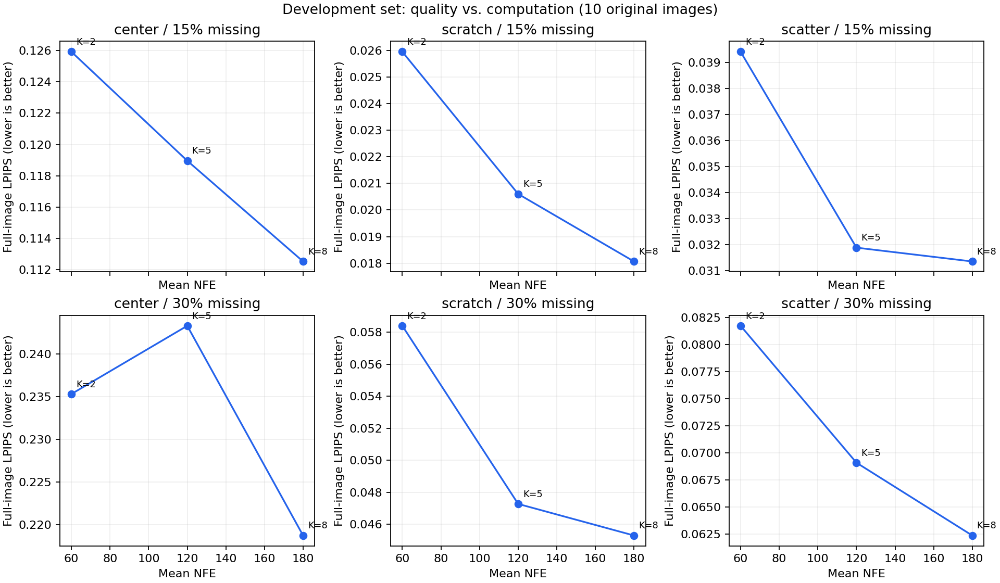

# 完整开发集预算分析

本结果用于选规则，属于开发集内结果；不能代替冻结后的独立测试集结论。

- 原图 10 张，图片与掩码组合 60 个，三档结果 180 条。
- 失败 0；缓存命中 114；完整集合等 NFE：True。
- M1 权重：[1.0, -1.0]；阈值：[-0.11411922637222555, 0.1875831629115261]。
- A1 权重：[1.0, 0.0]；阈值：[0.002944460691782089, 0.9958746532670442]。
- M1 相对 B2 的 LPIPS 降低比例：3.46%（正值改善，负值下降）。
- 从中预算增加到高预算，39/60 个组合的 LPIPS 改善。

| 策略 | LPIPS ↓ | 缺失区 PSNR ↑ | 边界 MAE ↓ | 总 NFE |
|---|---:|---:|---:|---:|
| B1 | 0.094452 | 18.0585 | 0.060508 | 3600 |
| B2 | 0.088518 | 19.1493 | 0.057296 | 7200 |
| B3 | 0.081394 | 19.4118 | 0.055540 | 10800 |
| M1 | 0.085453 | 18.9728 | 0.057748 | 7200 |
| A1 | 0.089444 | 18.8167 | 0.057139 | 7200 |
| C1 | 0.089196 | 18.7908 | 0.059480 | 7200 |

## 成本与下一步

三档采样累计耗时：1.769 小时；不含模型加载、评价和预热。
峰值显存最大值：2731.5 MB。
按原图汇总质量指标。预算收益表中的掩码组合不是独立原图样本。
下一步在查看测试效果前锁定规模与子集，加载本次冻结配置执行正式六策略对照。
开发集选择存在小样本过拟合风险，测试结果可能不复现这里的改善。

## 结果解释与完整性核验

M1 在相同总 NFE=7200 下将开发集全图 LPIPS 从 0.088518 降至 0.085453（降低 3.46%），但缺失区 PSNR 从 19.1493 降至 18.9728 dB，边界 MAE 从 0.057296 升至 0.057748。因此当前结果是主选择指标的改善，不能表述为所有质量指标都提升。

中预算增加到高预算时，39/60 个掩码组合的 LPIPS 改善；剩余 21 个组合未改善。中心 30% 缺失的均值曲线也并非随 K 单调改善，不能简单按迭代次数推断质量。

本轮复用前次 114 条结果，新增 66 次真实推理。报告中的采样累计耗时包含缓存元数据保存的原始推理时间，不是缓存读取时间，也不是本次续跑的墙钟耗时。2026-11-16 本次续跑及自动分析从 16:43:59 至 17:24:25（Asia/Shanghai），约 40 分 27 秒；另有一次单独记录的预热。

最终验证通过：180 个唯一档位记录、360 条策略记录、180 张结果图；114 张缓存图与前次文件哈希一致，37 个源码快照文件与来源记录一致；冻结配置加载、实际源码校验、测试集原图隔离检查通过。验证记录见 `verification.json`。

