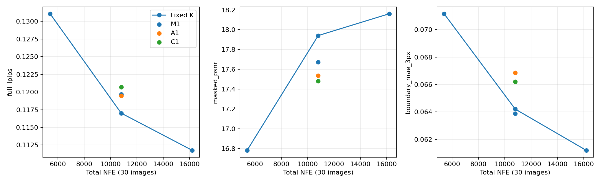

# 独立测试与复核报告

主测试 30 张独立原图，面积与三种子复核共用预选 10 张子集；四次运行共 540 条档位结果、1080 条策略记录。
各次运行通过完整性、输入哈希和实际 NFE 核验。使用开发集冻结参数，未依据测试效果重新选规则。

| 比较范围 | 原图数 | M1−B2 LPIPS | 95% 配对 bootstrap 区间 | 改善/持平/退化图数 |
|---|---:|---:|---|---|
| main_30_images | 30 | 0.002645 | [-0.001336, 0.006592] | 12/0/18 |
| subset_area30_seed42 | 10 | 0.004031 | [0.000257, 0.007658] | 2/0/8 |
| subset_area15_seed42 | 10 | -0.004350 | [-0.008808, -0.000112] | 6/0/4 |
| subset_area30_seed2026 | 10 | 0.007810 | [0.003932, 0.012154] | 1/0/9 |
| subset_area30_seed3407 | 10 | 0.007690 | [-0.002257, 0.017864] | 3/0/7 |
| subset_both_areas_seed42 | 10 | -0.000159 | [-0.002769, 0.002443] | 5/0/5 |
| subset_area30_three_seeds | 10 | 0.006510 | [0.003505, 0.009525] | 1/0/9 |

差值小于零表示 M1 的 LPIPS 更好；主比较为 30 图主测试，其余为子集复核。区间跨零时，收益证据有限。
先按原图平均掩码、面积或种子，再按原图配对重采样（10000 次，分析种子 42）。同图重复项不作为独立原图。
混合面积沿用各自运行的预算分配，不重新排序。跨三种子的合并区间反映原图不确定性，不能替代更多种子的验证。
四个完整运行等预算验收通过，但主测试的 10 图截取子集不自动保持所有策略等预算：种子 42、30% 面积子集的 M1/B2 均为 3600 NFE，A1 为 3000、C1 为 3360。因此上表 M1−B2 比较仍等预算，子集及其混合汇总中的 A1/C1 须同时报告实际成本。
完整六策略与辅助指标见 summary.csv，逐组配对指标见 paired_statistics.json。成本记录包含缓存的历史推理时间，不等于当前运行墙钟时间。

案例图与结构、纹理、语义失败分析仍需单独完成；不据单项指标概括为全面提升。
